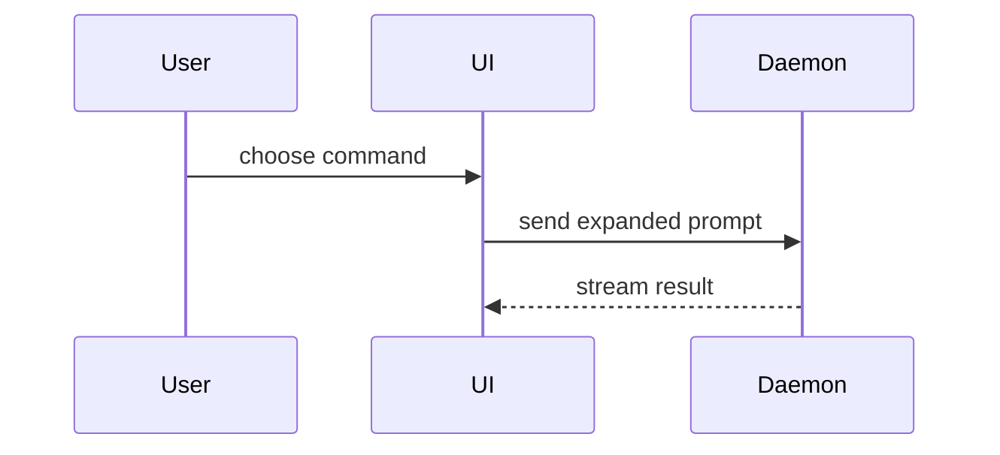

# PR body

Write the body into [template.md](./template.md): every section it has, in its order, no section it does not have.
Skip all preambles and keep prose brief.
Use the user's domain language from `GLOSSARY.md`.

## Summary

Pick the smallest view that makes the key point clear.

- Show logic or an algorithm as pseudocode:

```text
on(save)
  if content is unchanged
    return cached result
  write new content
  return fresh result
```

- Show runtime control flow as a call tree:

```text
submitForm
  createSession
    persistPrompt
    launchAgent
  navigateToSession
```

- Show UI structure as a component tree, including state and module boundaries that matter:

```text
<SessionPage> (apps/example/src/routes/session.tsx)
  useSessionEvents()
  <SessionToolbar>
    <RunSkillButton> (packages/ui)
```

- Show file responsibility or a broad refactor as a shallow file tree:

```text
src/
├── commands/       # parses user actions
├── sessions/       # owns session state
└── transport/      # sends API requests
```

- Show component interaction, control flow, or data flow with Mermaid:



- Use `diff` when the point is what changes and the surrounding shape already exists. Match the diff shape to the topic.

For a component change:

```diff
 <SessionPage>
   useSessionEvents()
   <SessionToolbar>
+    <RunSkillButton />
   <SessionTimeline>
+    <SkillResultCard />
```

For a file-layout change:

```diff
 src/
 ├── commands/
+│   └── show-me.ts       # expands the slash command
 ├── sessions/
-└── transport.ts
+└── transport/
+    ├── client.ts
+    └── stream.ts
```

For a call-tree or call-stack change:

```diff
 submitForm
   createSession
     persistPrompt
+    expandSkillMention
     launchAgent
-  navigateToSession
+  navigateToSession
+    subscribeToEvents
```

For a state or control-flow change:

```diff
 on(save)
-  write content
+  if content is unchanged
+    return cached result
+  write new content
+  invalidate cache
```

- Show the whole block when most of it is new, when omitted context would hide ownership or order, or when the user needs a copyable target shape:

```ts
function expandSkill(command: string): string {
  const skillName = command.slice(1);
  return `use the ${skillName} skill`;
}
```

Place each visual next to the short text it supports.
Keep only the calls, files, props, states, and boundaries needed to make the point.
One view is usual, several are possible, all of them never: use your judgement and keep the reader's attention.

## Evidence

Concrete evidence that the change works: a before and an after.

Screenshots are S-tier when the environment is set up for it and the change is visual.
Execution-based evidence is A-tier: test results, console output.
Show the exact test that now fails and passes, using pseudocode.

## Merge Danger

Say whether it is a one-way or two-way door.
You can walk back through two-way doors, not one-way doors; a PR that is cheap to roll back is lower risk, and destructive actions or hard-to-reverse decisions are one-way doors.

The blast radius is the potential impact or scope of the change.
Consider all possibilities: layout shift, breakages for consumers, mobile responsiveness, migrations.
