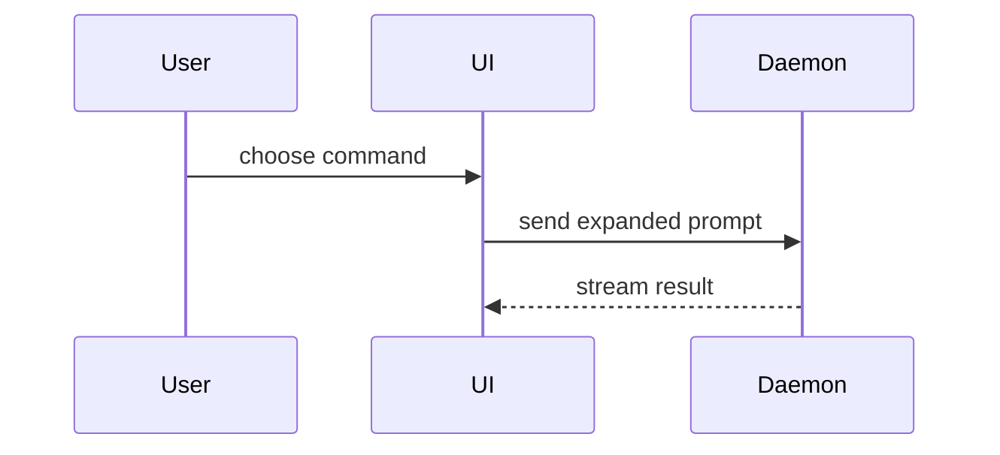

# pr

## Frontmatter

```yaml
name: pr
description: "Use when writing a PR or MR body: the user asks to open a PR, write the PR description, draft a merge request, or fill the PR template, or implement-spec marks its draft PR ready."
metadata:
  credits:
    skill: show-me
    author: Dex Horthy
    organisation: Humanlayer
    url: "https://github.com/humanlayer/skills/blob/main/plugins/show-me/skills/show-me/SKILL.md"
```

Invocation mode: model-invoked and typed by the user; no `disable-model-invocation`.
The description says only when to use the skill.

## Varies by

- `domain`: on makes the vocabulary sentence name where the glossary lives; off makes it "Use the vocabulary of the spec and the code."
- `templates`: `template.md` is Matt Pocock's PR template merged with the repo's own PR or MR template (`.github/PULL_REQUEST_TEMPLATE.md`, `.gitlab/merge_request_templates/`), its sections in the repo's order with Evidence and Merge Danger kept; with no repo template, the default text under Sibling files.

## Skill text

````markdown
# PR body

Write the body into [template.md](template.md): every section it has, in its order, no section it does not have.
Read the sources first: the epic's `.claude/flow/<epic-slug>/spec.md`, each ticket's `ticket.md`, the latest `review-NN.md` in each ticket folder and the epic folder, and the check output of the branch.
A finding declined in a review goes under Merge Danger with its reason.

## Sections

Skip all preambles and keep prose brief.
{setup: when domain is on, "Use the user's domain language from the glossary at <its location>."; when off, "Use the vocabulary of the spec and the code."}

### Summary

Pick the smallest view that makes the key point clear.

- Show logic or an algorithm as pseudocode:

```text
on(save)
  if content is unchanged
    return cached result
  write new content
  return fresh result
```

- Show runtime control flow as a call tree:

```text
submitForm
  createSession
    persistPrompt
    launchAgent
  navigateToSession
```

- Show UI structure as a component tree, including state and module boundaries that matter:

```text
<SessionPage> (apps/example/src/routes/session.tsx)
  useSessionEvents()
  <SessionToolbar>
    <RunSkillButton> (packages/ui)
```

- Show file responsibility or a broad refactor as a shallow file tree:

```text
src/
├── commands/       # parses user actions
├── sessions/       # owns session state
└── transport/      # sends API requests
```

- Show component interaction, control flow, or data flow with Mermaid:



- Use `diff` when the point is what changes and the surrounding shape already exists.
  Match the diff shape to the topic.

For a component change:

```diff
 <SessionPage>
   useSessionEvents()
   <SessionToolbar>
+    <RunSkillButton />
   <SessionTimeline>
+    <SkillResultCard />
```

For a file-layout change:

```diff
 src/
 ├── commands/
+│   └── show-me.ts       # expands the slash command
 ├── sessions/
-└── transport.ts
+└── transport/
+    ├── client.ts
+    └── stream.ts
```

For a call-tree or call-stack change:

```diff
 submitForm
   createSession
     persistPrompt
+    expandSkillMention
     launchAgent
-  navigateToSession
+  navigateToSession
+    subscribeToEvents
```

For a state or control-flow change:

```diff
 on(save)
-  write content
+  if content is unchanged
+    return cached result
+  write new content
+  invalidate cache
```

- Show the whole block when most of it is new, when omitted context would hide ownership or order, or when the user needs a copyable target shape:

```ts
function expandSkill(command: string): string {
  const skillName = command.slice(1);
  return `use the ${skillName} skill`;
}
```

#### Guidance

Place each visual next to the short text it supports.
Keep only the calls, files, props, states, and boundaries needed to make the point.

You may use one of these, you may use several, it is unlikely you will use all of them.
Use your judgement and don't overwhelm the reader.

### Evidence

Concrete evidence that the change works.
Show a before and after.

Screenshots are S-tier - when the environment is set up for it and the change is visual.

Execution-based evidence is A-tier.
Test results, console output.
Show the exact test that now fails and passes, using pseudocode.

### Merge Danger

Describe whether it's a one-way or two-way door.
You can walk back through two-way doors, but not one-way doors.
A PR that is cheap to roll back is lower risk.
Changes that involve destructive actions or hard-to-reverse decisions are one-way doors.

The blast radius is the potential impact or scope of the changes introduced by this PR.
Consider all possibilities.
Examples are layout shift, breakages for consumers, mobile responsiveness, migrations, etc.
````

## Sibling files

### template.md

{setup: the repo's own PR or MR template merged in, its sections in the repo's order, Evidence and Merge Danger kept; with no repo template, the text below unchanged}

````markdown
## Summary

<diagram, diff-sketch, or tree>

## Evidence

- **Before:** <screenshot/output/failing test run>
  **After:** <screenshot/output/passing test run>

## Merge Danger

**Door:** <one-way or two-way>

<optional: description>

**Blast Radius:** <one-word description>

<optional: potential ramifications of merge>
````

### CREDITS.md

Fixed text.

````markdown
# Credits

The **Summary** section's menu of visuals (pseudocode, call trees, component trees, file trees, Mermaid, diffs) and its placement guidance come from [Dex Horthy](https://github.com/dexhorthy)'s [`show-me`](https://github.com/humanlayer/humanlayer) skill, reproduced almost word for word and aimed at a diff instead of a live conversation.
`pr` does not depend on `show-me` as a skill (it isn't part of this repo, and a hard dependency would break standalone installs), so the content is copied in rather than pointed at; this file is the attribution a dependency would otherwise have carried.
````

## Handoffs

Calls no skill.
Names no next step; review and the flow skill name pr after a whole-branch review.
